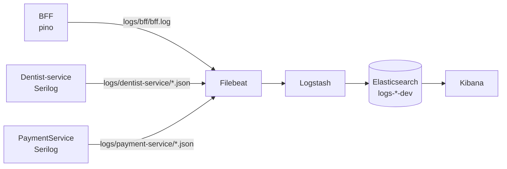

# Padrão de logs

Todos os serviços instrumentados (BFF, Dentist-service, PaymentService e a biblioteca
Messaging) gravam **uma linha JSON por evento**, no formato [ECS](https://www.elastic.co/guide/en/ecs/current/index.html)
(Elastic Common Schema). O Filebeat lê os arquivos, o Logstash normaliza e o
Elasticsearch indexa em `logs-<servico>-dev`.



## Campos

| Campo | Origem | Descrição |
|---|---|---|
| `@timestamp` | todos | Instante do evento (UTC). |
| `message` | todos | Mensagem legível. Sem dados pessoais. |
| `log.level` | todos | `debug`, `info`, `warn`, `error`, `fatal`. |
| `service.name` | todos | `bff`, `dentist-service`, `payment-service`. |
| `service.environment` | todos | Ambiente (`Development`, `development`...). |
| `event.action` | eventos do catálogo | Nome do evento (ver catálogo abaixo). |
| `event.duration` | quando aplicável | Duração em nanossegundos. |
| `labels.correlation_id` | todos, quando há requisição/evento | Id que liga BFF, Dentist-service, outbox, Kafka e Payment. |
| `labels.*` | .NET | Propriedades de negócio em `snake_case`, sempre string (`appointment_id`, `dentist_id`, `kafka_topic`...). |
| `http.request.method`, `http.response.status_code`, `url.path` | HTTP | `url.path` nunca inclui query string. |
| `error.type`, `error.message`, `error.stack_trace` | .NET | Exceção associada. |
| `error.code` | BFF | Código do `DomainError` (ex.: `INVALID_TOKEN`). |
| `trace.id`, `span.id` | .NET | Quando há `Activity` ativa. |

### Correlation id

O header `X-Correlation-Id` é aceito na entrada (ou gerado) pelo BFF, repassado ao
Dentist-service, gravado no envelope do evento Kafka e restaurado no consumidor. Em
todos os serviços ele aparece como `labels.correlation_id`.

No Kibana: `labels.correlation_id : "<id>"` (busca salva **Odonto | Trace por correlation_id**).

## Catálogo de eventos (`event.action`)

| Serviço | Evento | Nível | Quando |
|---|---|---|---|
| Dentist | `appointment.requested` | Information | Agendamento solicitado. |
| Dentist | `appointment.confirmed` | Information | Dentista confirmou. |
| Dentist | `appointment.rejected` | Information | Dentista rejeitou. |
| Dentist | `appointment.cancelled` | Information | Agendamento cancelado. |
| Dentist | `appointment.slot_conflict` | Warning | Horário indisponível. `labels.reason`: `outside_availability`, `overlap`, `concurrent_update`. |
| Dentist | `appointment.denied` | Warning | Operação negada. `labels.reason`: `dentist_foreign_schedule`, `service_not_owned_by_dentist`, `cancellation_too_late`. |
| Dentist | `schedule.weekly_updated` | Information | Agenda semanal alterada. |
| Dentist | `schedule.exception_updated` | Information | Exceção de agenda alterada. |
| Dentist | `availability.queried` | Debug | Consulta de disponibilidade. |
| Messaging | `outbox.enqueued` | Information | Evento gravado no outbox. |
| Messaging | `outbox.published` | Information | Publicado no Kafka (`labels.lag_ms` = tempo no outbox). |
| Messaging | `outbox.publish_failed` | Warning | Falha ao publicar; será repetido. |
| Messaging | `outbox.read_failed` | Error | Falha ao ler o outbox. |
| Messaging | `consumer.received` | Debug | Mensagem recebida. |
| Messaging | `consumer.handled` | Information | Mensagem processada. |
| Messaging | `consumer.skipped` | Information | Duplicada ou sem handler. |
| Messaging | `consumer.retry` | Warning | Nova tentativa após erro. |
| Messaging | `consumer.failed` | Error | Handler falhou na tentativa. |
| Messaging | `consumer.dead_lettered` | Error | Enviada para a DLQ. |
| Payment | `payment.created` | Information | Pagamento criado. |
| Payment | `payment.status_changed` | Information | Status alterado. |
| Payment | `payment.not_found` | Warning | Pagamento inexistente. |
| BFF | `auth.denied` | Warning | 401/403 (`error.code` traz o motivo). |
| BFF | `http.rate_limited` | Warning | 429 (inclui `client.ip`). |
| BFF | `downstream.timeout` | Warning | Timeout ao chamar um serviço (`destination.address`, `event.duration`). |
| BFF | `downstream.unavailable` | Warning | Falha de conexão com o serviço. |
| BFF | `downstream.error` | Warning | Resposta 5xx ou inválida do serviço. |

Além dos eventos, o BFF registra `request completed` por requisição (exceto `/health`) e
o Dentist/Payment registram o log de requisição do Serilog (`UseSerilogRequestLogging`).

## Níveis

| Nível | Uso |
|---|---|
| `debug` | Detalhe de diagnóstico; desligado em produção. |
| `info` | Transições de negócio bem-sucedidas. |
| `warn` | Situação esperada porém anômala: conflito, acesso negado, retry. |
| `error` | Falha que exige atenção: DLQ, exceção não tratada. |

Respostas 4xx por erro do cliente são `warn` no log de acesso do BFF; 5xx são `error`.

## Dados pessoais (LGPD)

**Nunca** registrar: tokens/JWT, header `Authorization`, cookies, CPF, e-mail, telefone,
número ou nome do convênio, nem corpo de requisição.

- Identificadores técnicos (`appointment_id`, `payment_id`, `dentist_id`) são permitidos.
- Query strings são removidas de `url.path`.
- O BFF não serializa headers do request; `authorization` e `cookie` também são
  redigidos (`redact`) como rede de segurança.
- O Logstash mascara CPF, e-mail e `Bearer <token>` em `message` e `error.*` como defesa
  em profundidade — isso **não** substitui evitar o dado na origem.

## Exemplos

Agendamento (Dentist-service):

```json
{"@timestamp":"2026-10-18T13:20:11.482Z","message":"Agendamento 3f2a... solicitado","log":{"level":"info","logger":"DentistsServices.Api.Controllers.AppointmentsController"},"ecs":{"version":"8.11.0"},"service":{"name":"dentist-service","environment":"Development"},"event":{"action":"appointment.requested"},"labels":{"correlation_id":"teste-123","appointment_id":"3f2a...","dentist_id":"9b1c..."}}
```

Acesso negado (BFF):

```json
{"log.level":"warn","@timestamp":"2026-10-18T13:18:37.247Z","service.name":"bff","labels":{"correlation_id":"teste-123"},"context":"DomainExceptionFilter","event":{"action":"auth.denied"},"http":{"response":{"status_code":401}},"url":{"path":"/api/dentist-services"},"error":{"code":"INVALID_TOKEN"},"message":"Acesso negado"}
```

## Como adicionar um evento novo

1. **.NET:** declarar um método `[LoggerMessage(EventId = ..., EventName = "dominio.acao", ...)]` na classe de log do serviço (`AppointmentsLog`, `PaymentLog`, `MessagingLog`). O `EventName` vira `event.action`. Dados de negócio entram como parâmetros (viram `labels.*`).
2. **BFF:** adicionar a constante em `bff/src/shared/infrastructure/logging/log-events.ts` e logar `{ event: { action } }` com o `Logger` do Nest. Para `labels` extras, usar `labels: { ... }` (o `correlation_id` é preservado).
3. Documentar o evento no catálogo acima e, se fizer sentido, na busca salva do Kibana.

## Retenção

Política ILM `odonto-logs-policy`: 7 dias em desenvolvimento, depois exclusão. Os data streams
são `logs-<servico>-dev` (hífens do nome viram `_`).
